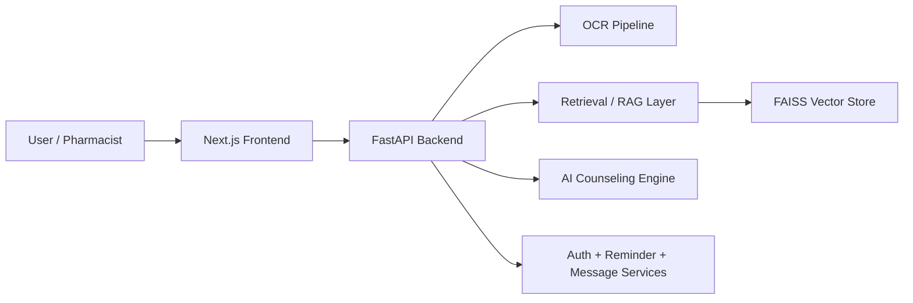

# AYNUR VITA

Your Health, In a New Light

AYNUR VITA is a patient-first digital health platform for hospitals, pharmacies, and patients across Pakistan. It combines prescription intelligence, AI-assisted medication guidance, and care coordination tools to improve safety, trust, and treatment outcomes.

## Overview

AYNUR VITA is designed to help healthcare teams and patients access safer, more informed medication support. The platform brings together:

- prescription image upload and OCR
- automated medicine extraction
- retrieval-augmented knowledge lookup for medications
- AI-generated counseling summaries
- pharmacist chat assistance
- reminder and communication management
- operational dashboard views for pharmacy workflows

## Architecture



## Core Features

### Prescription intelligence
- upload prescription images
- detect medicines from scanned prescriptions
- extract structured text and review medication information
- generate counseling data for detected medicines

### Medication knowledge
- query medicine-specific information from indexed knowledge sources
- retrieve contextual references using a vector search workflow
- support pharmacist-led knowledge checks before patient counseling

### AI pharmacist support
- conversational assistant for medication questions
- grounded answer generation based on medicine context
- structured response handling for frontend display

### Workflow support
- reminder management APIs
- message and communication flows
- role-based access for pharmacists
- dashboard views for operational monitoring

## Tech Stack

### Backend
- Python
- FastAPI
- Pydantic
- FAISS
- OCR/image processing
- Gemini-based AI integration

### Frontend
- Next.js
- React
- TypeScript
- Tailwind CSS
- Recharts

## Project Structure

```text
AYNUR VITA/
├── backend/
│   ├── app/
│   │   ├── main.py
│   │   ├── schemas.py
│   │   ├── data/
│   │   ├── rag/
│   │   ├── routes/
│   │   ├── services/
│   │   ├── utils/
│   │   └── vectorstore/
│   ├── requirements.txt
│   └── tests/
├── frontend/
│   ├── app/
│   ├── components/
│   ├── hooks/
│   ├── lib/
│   ├── public/
│   ├── package.json
│   ├── next.config.mjs
│   └── tsconfig.json
├── images (3).jfif
├── prescription.jpeg
├── sample.png
├── AYNUR VITA PRD.docx
├── README.md
└── .gitignore
```

## Prerequisites

Before running the project, ensure you have:

- Python 3.10 or newer
- Node.js 18 or newer
- pnpm
- pip for backend dependencies

## Environment Setup

Copy the variables from [`.env.example`](.env.example) into the appropriate frontend and backend environment files. The app uses:

```env
BACKEND_URL=https://aynur-vita-backend.onrender.com
NEXT_PUBLIC_API_URL=https://aynur-vita-backend.onrender.com/api
GEMINI_API_KEY=
GROQ_API_KEY=
ALLOWED_ORIGINS=*,https://aynur-vita.vercel.app,http://localhost:3000
```

Set the AI provider keys required by the features you enable. For production, restrict `ALLOWED_ORIGINS` to trusted frontend domains.

## Quick Start

### 1) Start the backend

```bash
cd backend
python -m venv .venv

# Windows PowerShell
.\.venv\Scripts\Activate.ps1

# macOS/Linux
# source .venv/bin/activate

pip install -r requirements.txt
uvicorn app.main:app --reload --host 0.0.0.0 --port 8000
```

The backend is then available at:

- http://localhost:8000
- Swagger UI: http://localhost:8000/docs

### 2) Start the frontend

```bash
cd frontend
pnpm install
pnpm dev
```

The frontend will run at:

- http://localhost:3000

## Typical Workflow

1. Open the frontend dashboard.
2. Log in as a pharmacist or configured user.
3. Upload a prescription image.
4. Review OCR-extracted medicines.
5. Use the AI or knowledge tools to gather medication guidance.
6. Generate counseling recommendations and support patient education.

## Notes

- The backend includes a medicine knowledge index stored under the vector store folder.
- Some AI-powered features depend on external API keys and valid model access.
- The frontend and backend are designed to work together via the local API configuration and origin settings.

## Deployment

### Frontend deployment

Deploy the Next.js frontend to Vercel and set this environment variable:

```bash
NEXT_PUBLIC_API_URL=https://aynur-vita-backend.onrender.com/api
```

### Backend deployment

The [render.yaml](render.yaml) Blueprint configures the FastAPI backend as a free-tier Render web service. It exposes the API under `/api/v1`; the root path provides a health check.

Set these values in Render:

- `BACKEND_URL=https://aynur-vita-backend.onrender.com`
- `GEMINI_API_KEY` and, optionally, `GROQ_API_KEY`
- `ALLOWED_ORIGINS=https://aynur-vita.vercel.app`

The free tier can sleep when idle and does not provide persistent local storage. The current SQLite database is stored locally, so production use requires persistent storage or a managed database.


## License


## Contributing

Contributions are welcome. A good workflow is:

1. fork the repository
2. create a feature branch
3. keep backend and frontend updates organized
4. validate locally before opening a pull request
